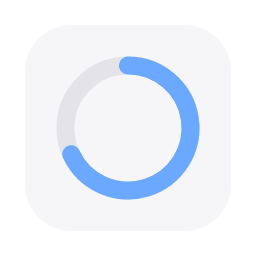
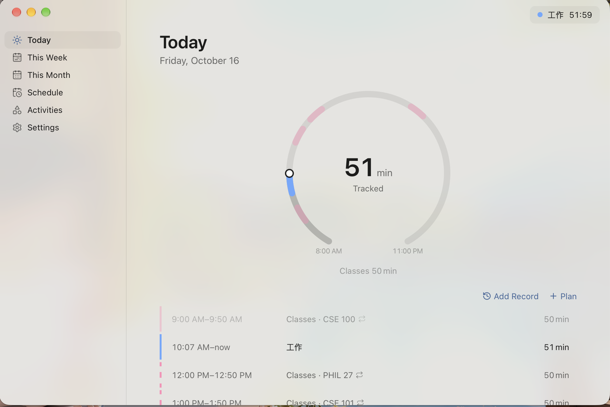
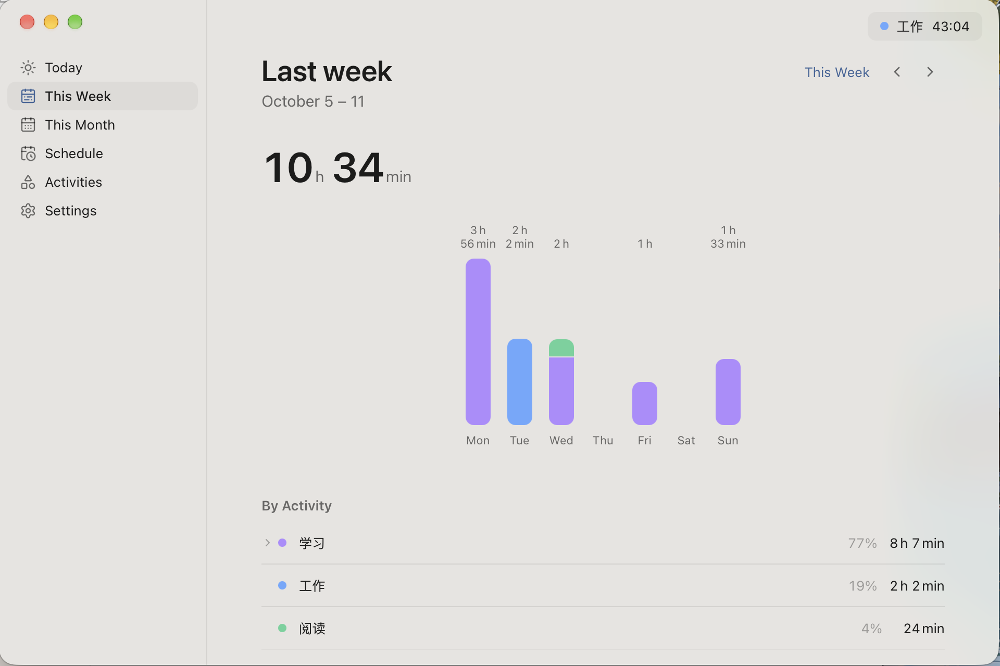
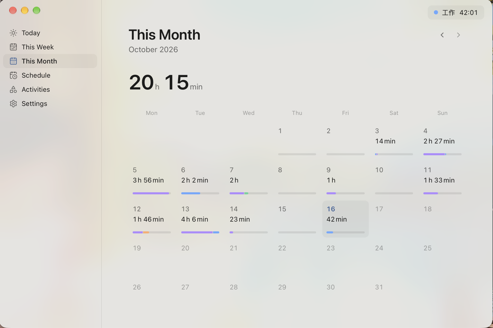
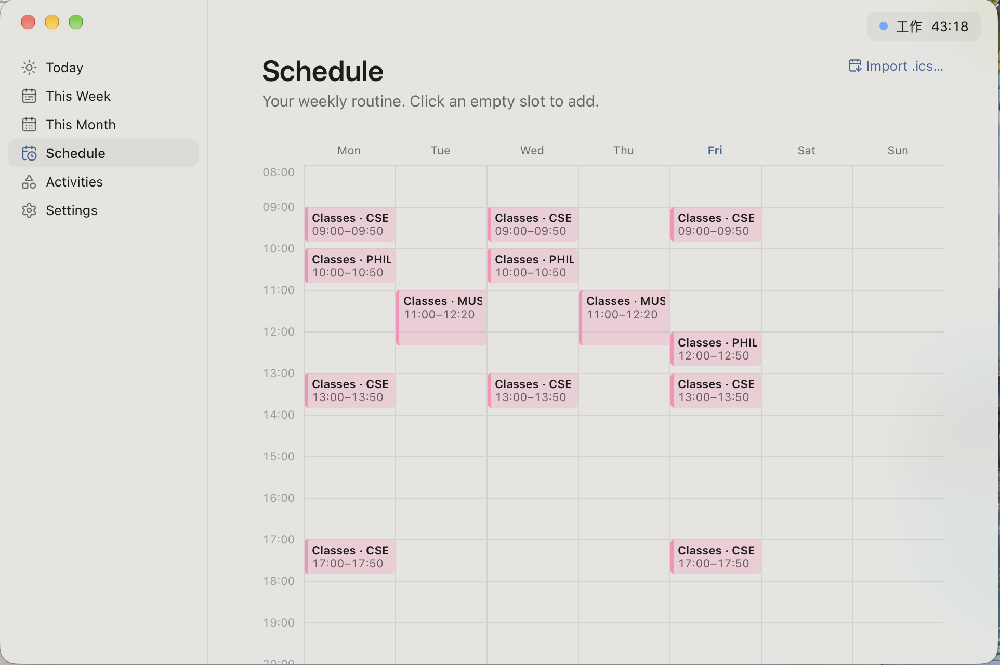
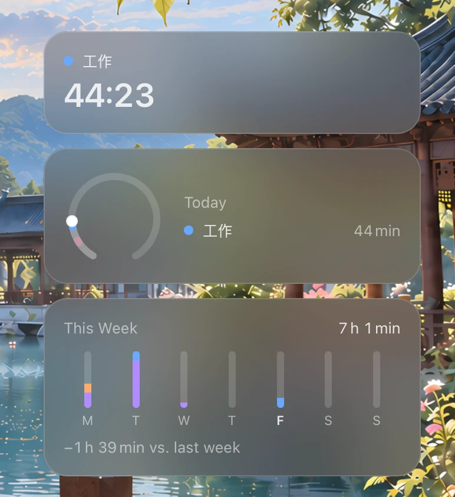
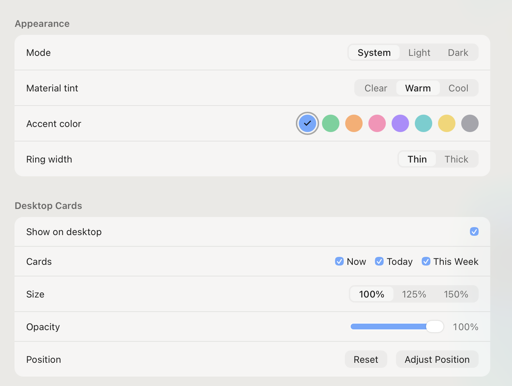
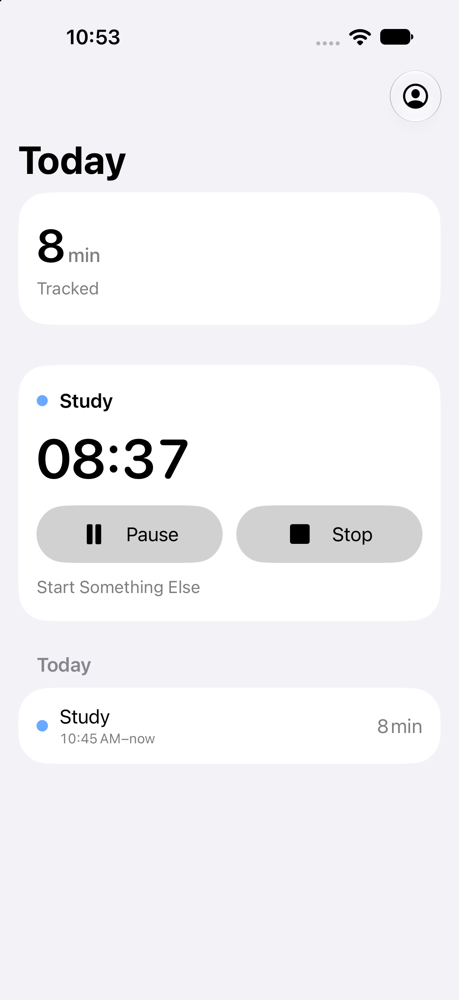
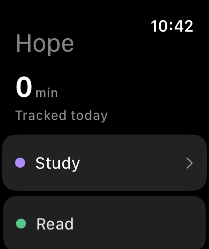
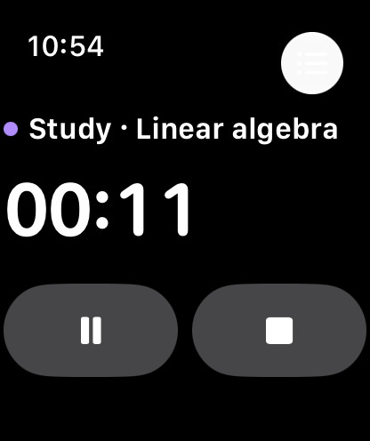

  

<h1 align="center">Hope</h1>

  A calm time tracker. See what you did while you were awake, as a ring. 
  <a href="README.zh-CN.md">中文说明</a>

  
  
  

---

## Before you download

- **Available now: macOS and Windows.** Get the installer from [Releases](https://github.com/dan9574/hope-time-tracker/releases). The builds are not code-signed yet, so the first launch takes one extra step: on macOS, right-click `Hope.app` → **Open**; on Windows, click **More info → Run anyway** on the SmartScreen dialog. There is no expiry.
- **Not available yet: iPhone and Apple Watch.** Both apps exist and run on our own devices (you can see them below), but they are **not on the App Store yet**. The front end and the back end are still being developed, so for now Hope ships on the desktop only.
- **Android:** not planned, unless people ask for it.

---

## What it is

Hope tracks the time you choose to spend on things, one timer at a time, and shows the day as a ring from the moment you woke up to the moment you go to sleep. It is deliberately quiet: no streaks, no gamification, no colour anywhere except on your own activities.

  

## Features

### Every day, week and month

- **Today** — the ring spans wake-up to bedtime, with every record drawn on it, the running timer ticking, and a timeline of the day underneath. Record when you actually got up and went to bed with one button.
- **This week** and **this month** — totals per activity and per day, so you can see where the hours went.
- **Schedule** — one-off and recurring plans; recurring ones can log themselves when their time comes. Import a university timetable from an `.ics` file: classes become their own group and stay out of your totals by default, because class time is not the time you chose.

  
  

  

### Activities, journal, cards

- **Activities** with one level of sub-activities, eight colours, drag to reorder, archive what you no longer do.
- **Records** you can edit, split, move or delete; a **journal** entry per day.
- **Desktop cards** — three small cards (now, today, this week) that sit on your desktop under the icons, with a real blur behind them on macOS and Windows.
- **Menu bar / tray timer** — start, pause and stop without opening the window.
- **Themes** — light, dark or system; a warm or cool tint; your accent colour; thin or thick ring.
- **Your data is yours** — everything is in a local SQLite file, and you can export and import it as JSON at any time.

  
  &nbsp;&nbsp;
  

### Sync

Hope works fully offline. If you want the same data on more than one computer, create an account in **Settings → Sync** (an email and a password; the data goes to our Supabase project under your own account and nobody else can read it). Sign in on another machine and the two converge.

### Reminders about time and distance

Two reminders, both off by default on the phone and on by default on the watch, and both skipped for exercise and for class time:

- **Take a break** — every 90 minutes of running time (pauses excluded) a notification asks whether to pause or keep going. The watch reminds first, the desktop a minute later, the iPhone two minutes later only if neither did.
- **You walked away** — the iPhone notices when you are more than 300 m from where the timer was started and asks whether to stop it: *Keep going* (re-anchor here), *Stop*, or *Not for 30 minutes*.

Because the iPhone app is not released yet, the desktop build gives you the break reminder on its own.

## iPhone and Apple Watch

Not downloadable yet — this is what they look like.

  
  &nbsp;&nbsp;
  
  &nbsp;&nbsp;
  

- **Apple Watch** — the place to start a timer: a list of your activities with today's total, a big ticking timer with pause and stop, a watch-face complication that shows the running activity in its colour (or today's total when idle), and the break reminder on your wrist.
- **iPhone** — a minimal companion: today's total and records, start / pause / stop, your account, and the away reminder. It hands your sign-in to the watch.

## What comes next

All of this is in development and will be supported:

- The iPhone and Apple Watch apps on the **App Store**.
- **Connect your own database** from inside the app. Today a build is tied to one Supabase project at build time (the installers above use ours; you just sign up); the setting will move into the app so you can point it at a project you own.
- **Realtime sync**, so a timer started on the watch appears on the desktop cards within a second.
- **Android**, if there is demand.

## Build it yourself

- Desktop: Node ≥ 20.19 and Rust. `npm ci`, then `npm run tauri dev`; `npm run tauri build` makes the installer for your platform.
- Your own Supabase project: see [supabase/README.md](supabase/README.md). Without a `.env` the build runs local-only.
- iPhone and Apple Watch: Xcode 26, see [apple/README.md](apple/README.md).

The architecture, data model and design system are written down in [docs/rebuild-plan.md](docs/rebuild-plan.md) (in Chinese).

## License

[MIT](LICENSE)
